# ANSI/IEEE Std 488.1-1987 — Section 2.9: Parallel Poll (PP) Interface Function

**Source:** User-supplied `IEEE-488-1_87.pdf`, printed pages 37–41 (PDF pages 45–49).  
**Language:** English, preserved from the source.  
**Scope:** All of Section 2.9, including Figure 11, Tables 24–27, their notes and footnotes. Section 2.10 is NOT included.  
**Transcription policy:** Body paragraphs have been reflowed without intentional substantive edits. Images of the state diagram and image-only tables are represented as explicit text. Original text/figure facts and editorial machine-readable interpretations are marked separately. Square brackets in the Figure 11 transition equations are *part of the standard's optional-transition notation* (see 2.2.1), not arbitrary editorial brackets.

---

## 2.9 Parallel Poll (PP) Interface Function

### 2.9.1 General Description

The PP interface function provides a device with the capability to present a PPR message to the controller in charge without being previously addressed to talk.

The signal lines DIO1 through DI08 are used to convey the device status bits during the parallel poll. In order for a device to respond with a PPR message, a device shall have been assigned (configured) to a single DIO line either by the controller or by a local message. This allows up to eight devices with a one-line-per-device assignment although any number of devices can be handled through sharing of DIO lines.

The use of the parallel poll facility within a system requires a commitment of the current interface controller to conduct a parallel poll, as required.

The parallel poll facility can be used to indicate a request for service. This capability differs from use of the SRQ message in the following ways:

1. A controller initiates a parallel poll sequence whereas any device requests the initiation of a serial poll sequence.
2. A parallel poll enables the transfer of status data from multiple devices concurrently whereas a serial poll sequentially collects status data from each device.

### 2.9.2 PP Function State Diagram

The PP interface function shall be implemented so as to perform according to the state diagram given in Fig 11 and the state descriptions given throughout 2.9. Table 24 specifies the set of messages and states required to effect transition from one active state to another. Table 25 specifies the messages that should be sent and the device function interaction required by the function while each state is active.

#### Figure 11 — PP State Diagram (complete transcription into text)

The drawing consists of TWO separately drawn groups of states:

**Group A — Parallel poll response states:** `PPIS`, `PPSS`, `PPAS`.

| From state | To state | Exact conditions transcribed from diagram, in normalized Unicode notation | Timing |
|---|---|---|---|
| Power-on (`pon`) | `PPIS` | `pon` | — |
| `PPIS` | `PPSS` | `[PPE ∧ PACS ∧ ACDS] ∨ [lpe]` | — |
| `PPSS` | `PPIS` | `[(((PPD ∧ PACS) ∨ PPU) ∧ ACDS)] ∨ [¬lpe]` | — |
| `PPSS` | `PPAS` | `IDY ∧ ATN` | within `t5` |
| `PPAS` | `PPSS` | `¬ATN ∨ ¬IDY` | within `t5` |

**Group B — Parallel poll configuration states:** `PUCS`, `PACS`.

| From state | To state | Exact conditions transcribed from diagram, in normalized Unicode notation | Timing |
|---|---|---|---|
| Power-on (`pon`) | `PUCS` | `pon` | — |
| `PUCS` | `PACS` | `PPC ∧ LADS ∧ ACDS` | — |
| `PACS` | `PUCS` | `PCG ∧ ¬PPC ∧ ACDS` | — |

**Original figure note:** "NOTE: See Table 27 for restrictions on use of the optional transitions."

**Figure notation:** `∧` = AND; `∨` = OR; `¬` = NOT (an overbar in the drawing). `[ ... ]` = an OPTIONAL transition term (depending on implemented PP subset). The ovals drawn around `PACS`, `ACDS`, and `LADS` in transition expressions denote state linkages, not separately transmitted messages. `pon` enters both initial states on power-on. The two state groups are distinct, so being in one of the Group A states does not itself mean that Group B stops being in one of its states.

**Optional machine-readable Mermaid equivalent of Figure 11:**

```mermaid
stateDiagram-v2
    state "PP response group" as Response {
        [*] --> PPIS: pon
        PPIS --> PPSS: [PPE AND PACS AND ACDS] OR [lpe]
        PPSS --> PPIS: [((PPD AND PACS) OR PPU) AND ACDS] OR [NOT lpe]
        PPSS --> PPAS: IDY AND ATN; within t5
        PPAS --> PPSS: NOT ATN OR NOT IDY; within t5
    }
    state "PP configuration group" as Configuration {
        [*] --> PUCS: pon
        PUCS --> PACS: PPC AND LADS AND ACDS
        PACS --> PUCS: PCG AND NOT PPC AND ACDS
    }
```

The Mermaid diagram is an *editorial rendering* of the original figure; the preceding transition tables are the preferred precise transcription.

#### Table 24 — PP Mnemonics (complete)

**Messages**

| Symbol | Meaning |
|---|---|
| `pon` | power on |
| `ist` | individual status (Table 25) |
| `lpe` | local poll enabled |
| `ATN` | attention |
| `IDY` | identify |
| `PPE` | parallel poll enable |
| `PPD` | parallel poll disable |
| `PPC` | parallel poll configure |
| `PCG` | primary command group |
| `PPU` | parallel poll unconfigure |

**Interface States**

| Symbol | Meaning / cross-function reference |
|---|---|
| `PPIS` | parallel poll idle state |
| `PPSS` | parallel poll standby state |
| `PPAS` | parallel poll active state |
| `PUCS` | parallel poll unaddressed to configure state |
| `PACS` | parallel poll addressed to configure state |
| `ACDS` | accept data state (AH Function) |
| `LADS` | listener addressed state (L Function) |

#### Table 25 — PP Message Outputs (complete)

Header in the standard: **Remote Message Sent** applies to the `PPRn*†` column.

| PP State | Qualifier (as printed) | Remote Message Sent: `PPRn*†` | Device Function Interaction |
|---|---|---|---|
| `PPIS` | — | `(F)` | none |
| `PPSS` | — | `(F)` | none |
| `PPAS` | `ist ≡ S` | `T` | none |
| `PPAS` | `ist ≡ S` | `(F)` | none |

Original footnotes:

- `*` See 2.9.3.3, second paragraph.
- `†` This column refers only to the specific message assigned by the device.

**Important source discrepancy — do not silently normalize:** Both PPAS qualifiers in the supplied PDF's Table 25 *visibly read* `ist ≡ S`, despite one row specifying `T` and the other `(F)`. Paragraph 2.9.3.3 explicitly requires active true if and only if `ist == S`, so the operational interpretation of the second row is `ist != S` → `(F)`. The table above is preserved as printed; this interpretation is editorial, not a verbatim replacement.

**Message output notation** (defined by the standard in 2.2.2): `T` = active true; `F` = active false; `(T)` = passive true; `(F)` = passive false.

### 2.9.3 PP State Descriptions

#### 2.9.3.1 Parallel Poll Idle State (PPIS)

In PPIS the PP function is unable to respond to a parallel poll issued by the interface controller.

The PP function powers on in PPIS.

In PPIS all parallel poll response (PPR) messages shall be sent passive false.

The PP function shall exit PPIS and enter the parallel poll standby state (PPSS) if either:

1. The parallel poll enable (PPE) message is true and PACS and ACDS are active
2. Or the local poll enabled (lpe) message is true

NOTE — Both the lpe and PPE transitions are optional; only one shall be used at any given time.

#### 2.9.3.2 Parallel Poll Standby State (PPSS)

In PPSS the PP function is able to respond to parallel polls issued by the device controller whenever they occur.

In PPSS all PR messages shall be sent passive false.

The PP function shall exit the PPSS and enter:

1. The parallel poll active state (PPAS) within t5 if the identify (IDY) and ATN messages are true (a parallel poll is in progress)
2. The PPIS if:
   a. The lpe message is false
   b. Or the parallel poll disable (PPD) message is true and PACS and ACDS are active
   c. Or the parallel poll unconfigure (PPU) message is true and ACDS is active

NOTE — Both the lpe and PPD transitions are optional; only one shall be used at any given time.

#### 2.9.3.3 Parallel Poll Active State (PPAS)

In PPAS the PP function is responding to the parallel poll currently being conducted by the interface controller.

In PPAS one of the PPR messages shall be sent true if, and only if, the value of the individual status (ist) message is equal to the value of the sense (S) bit received as part of the most recently received PPE command. The PPR message to be sent shall be the one specified by the three bits P1 through P3 received as part of the most recently received PPE command. Table 26 lists the PPR message specified by each of the combinations of values of P1 through P3 (see 2.9.5). All other PPR messages should be sent passive false.

#### Table 26 — PPR Message Specified by Each of the Combination of Values P1 Through P3 (complete)

Original grouped heading for first three columns: **Bits Received with Most Recent PPE Command**.

| P3 | P2 | P1 | PPR Message Specified |
|---:|---:|---:|---|
| 0 | 0 | 0 | `PPR1` |
| 0 | 0 | 1 | `PPR2` |
| 0 | 1 | 0 | `PPR3` |
| 0 | 1 | 1 | `PPR4` |
| 1 | 0 | 0 | `PPR5` |
| 1 | 0 | 1 | `PPR6` |
| 1 | 1 | 0 | `PPR7` |
| 1 | 1 | 1 | `PPR8` |

The PP interface function shall exit PPAS and enter PPSS within t5 if either the IDY or ATN message is false (the parallel poll is over).

#### 2.9.3.4 Parallel Poll Unaddressed to Configure State (PUCS)

In PUCS the PP function shall ignore any PPE or PPD messages which might be received over the interface. The PP function powers on in PUCS.

The PUCS does not provide a remote message sending capability.

The PP function shall exit PUCS and enter the parallel poll addressed to configure state (PACS) if the PPC message is true, and LADS and ACDS are active.

#### 2.9.3.5 Parallel Poll Addressed to Configure State (PACS)

In PACS the PP function is able to act upon PPE or PPD messages received over the interface. If a PPE message is received, the attendant bits S, P1, P2, and P3 should be saved by the function.

The PACS does not provide a remote message sending capability.

The PP function shall exit PACS and enter PUCS when the PCG message is true, the parallel poll configure (PPC) message is false and ACDS is active

### 2.9.4 PP Interface Function Allowable Subsets

The only allowable subsets to the parallel poll interface function shall be those listed in Table 27.

#### Table 27 — Allowable Subsets to PP Interface Function (complete)

| Identification | Description | States Omitted | Other Requirements | Other Function Subsets Required |
|---|---|---|---|---|
| `PP0` | no capability | all | none | none |
| `PP1` | remote configuration | none | include `[((PPD ∧ PACS) ∨ PPU) ∧ ACDS]`; include `[PPE ∧ PACS ∧ ACDS]`; exclude `lpe` | `L1–L4` or `LE1–LE4` |
| `PP2` | local configuration | `PUCS`, `PACS` | include `lpe`; exclude `[((PPD ∧ PACS) ∨ PPU) ∧ ACDS]`; exclude `[PPE ∧ PACS ∧ ACDS]`; local messages shall be substituted for `S`, `P1`, `P2`, `P3` | none |

The original table has one row per subset; semicolons above merely separate multiple requirements printed on separate lines in a single cell. In the printed source, `L1–L4` and `LE1–LE4` denote sets of allowable listener-function subsets (not a subtraction expression).

### 2.9.5 Additional PP Interface Function Requirements and Guidelines

If subset PP2 is taken, field-settable local messages shall substitute for the PPE command to specify PPR message and the message sense to be used during a parallel poll.

---

## Editorial fidelity notes (NOT part of the IEEE text)

1. **Text versus images:** Figure 11 is converted to two state transition tables and an optional Mermaid diagram. Tables 24 and 27 are transcribed from the rendered image (they were not present as ordinary extractable text). Tables 25 and 26 were checked against the page renders. There are no other figures/tables within Section 2.9.
2. **Table 25 inconsistency:** Both printed PPAS qualifiers read `ist ≡ S`. Use the explicit *if and only if* wording in 2.9.3.3 to distinguish `ist == S` (send active true) from `ist != S` (send passive false), rather than assuming the printed table has the correct second condition.
3. **Source typographical/transcription oddities preserved:** The prose in 2.9.1 says `DI08` (apparently intended `DIO8`); the prose in 2.9.3.2 says `PR messages` (apparently intended `PPR messages`). The ungrammatical table caption in Table 26 is also retained. Clear PDF-extraction `ff`/`if` character substitutions are rendered as `if` where context is unequivocal.
4. **Subset selection matters:** The `[PPE ...]` and `[PPD ...]` Figure 11 arcs are included for PP1 and excluded for PP2; the local `lpe` arcs are excluded for PP1 and included for PP2. This follows Table 27 and is not an extra requirement.
5. **`t5` is referenced, not numerically specified, in Section 2.9.** A numeric timing limit cannot be inferred from these pages alone; use the referenced timing table elsewhere in the standard when implementing or verifying timing.
6. **Derived convenience formula, not a direct quote:** For the selected line, `PPR_index = 1 + P1 + 2*P2 + 4*P3`. This restates Table 26 without adding new mappings.
7. **Scope boundaries:** No information from Annex G or Section 2.12 has been inserted into the transcription. Those are outside Section 2.9 and may supply additional system/controller context in a separate analysis.
